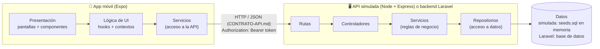
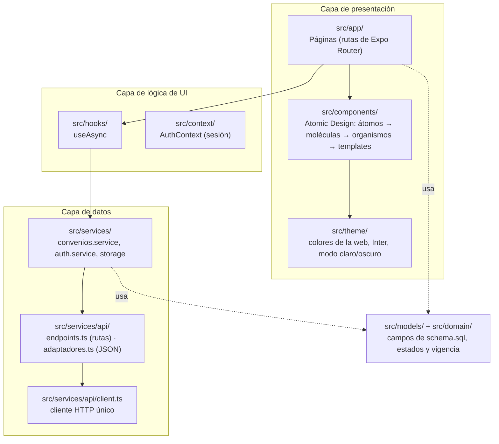
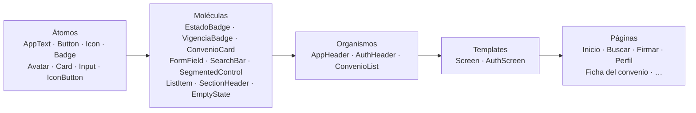
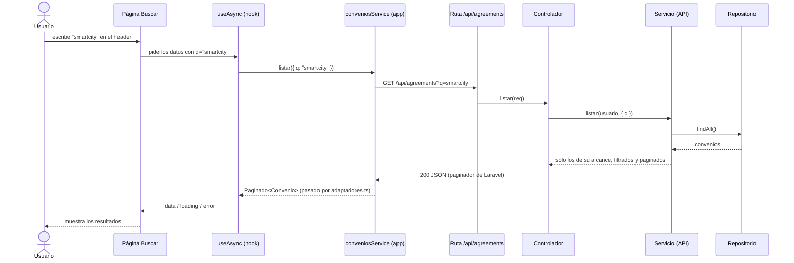
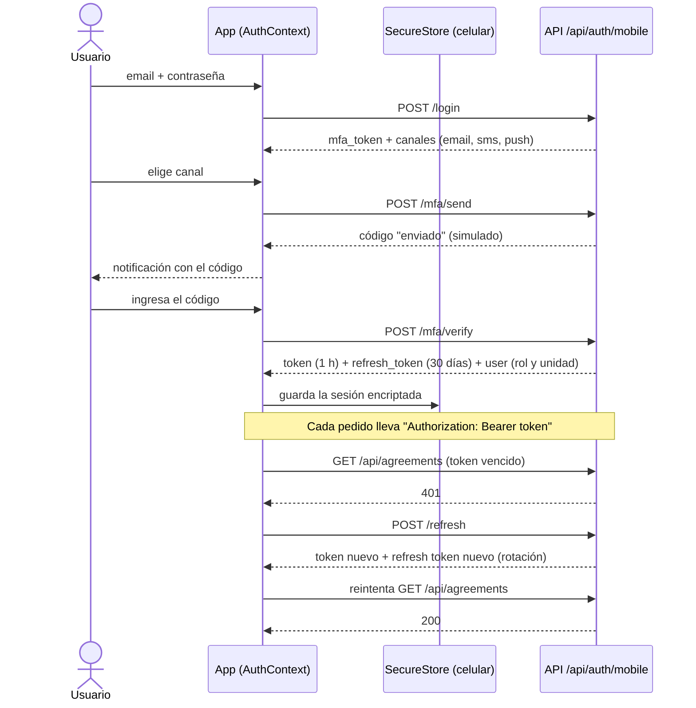

# Arquitectura de la app móvil

La parte móvil tiene dos piezas: la **app** (React Native + Expo) y una **API simulada** (Node + Express, en `mobile/api/`)
que responde igual que el backend de Laravel según `web/CONTRATO-API.md`. La app puede hablar con cualquiera de las dos
cambiando solo la URL.

Las dos están organizadas en **capas**: cada capa tiene una sola responsabilidad y solo habla con la capa de abajo.
Así se puede cambiar una capa (por ejemplo, pasar de la API simulada al backend real) sin tocar las demás.

## Vista general

## App — capas

| Carpeta | Responsabilidad |
|---|---|
| `src/app/` | **Páginas.** Cada archivo es una pantalla (Expo Router). Arman la pantalla con componentes y piden datos con hooks. No llaman a la API directamente. |
| `src/components/atoms/` | **Átomos:** piezas mínimas (texto, botón, ícono, badge, avatar, input, card). |
| `src/components/molecules/` | **Moléculas:** combinan átomos (tarjeta de convenio, insignias de estado y vigencia, campo con etiqueta, buscador, selector). |
| `src/components/organisms/` | **Organismos:** secciones completas (header con buscador, listado de convenios). |
| `src/components/templates/` | **Templates:** estructura base de una pantalla (`Screen`, `AuthScreen`). |
| `src/theme/` | Colores claro/oscuro (los de la web), tipografía Inter, tamaños de letra, espaciados. |
| `src/hooks/` | Lógica reutilizable de UI (carga de datos, estados de carga y error). |
| `src/context/` | Estado global: sesión del usuario (`AuthContext`). |
| `src/services/` | **Acceso a datos.** Única capa que conoce la API y el almacenamiento local. `api/endpoints.ts` tiene todas las rutas y `api/adaptadores.ts` normaliza el JSON (igual que `web/lib/api/`). |
| `src/models/` | Tipos con los mismos campos que `database/schema.sql` (convenio, parte, persona, documento, transición…). |
| `src/domain/` | Estados, tipos, roles y cálculo de vigencia: los mismos textos y reglas que `web/lib/dominio.js`. |
| `src/config/` | Configuración (URL de la API). |
| `src/utils/` | Funciones auxiliares (formato de fechas). |

## Atomic Design

Ejemplo concreto: la página **Inicio** usa el template `Screen` y el organismo `ConvenioList`.
`ConvenioList` usa la molécula `ConvenioCard`, que combina los átomos `Card`, `AppText` e `Icon` con las moléculas
`EstadoBadge` y `VigenciaBadge`, que a su vez son un `Badge` (átomo).

En la app hay una pantalla **Perfil → Componentes** que muestra todo el catálogo.

## API simulada — capas

| Carpeta | Responsabilidad |
|---|---|
| `src/routes/` | Define las URLs del contrato (`GET /api/agreements`, …) y a qué controlador van. |
| `src/controllers/` | Lee la request (parámetros, query, body, usuario) y devuelve la respuesta HTTP. |
| `src/services/` | Reglas de negocio: alcance por rol, filtros, paginación, MFA. No sabe de HTTP. |
| `src/domain/` | Estados, tipos y vigencia (igual que la web). |
| `src/repositories/` | Acceso a los datos. Arman el JSON con la forma que devolvería Laravel. |
| `src/data/` | `seed.js` (copia de `database/seeds.sql`), `extra.js` (datos solo para la app) y `db.js`. |
| `src/middlewares/` | Logs, errores con el formato de Laravel y `requireAuth` (valida el token). |
| `src/utils/` | Auxiliares (errores HTTP, criptografía, normalización de texto). |

## Flujo de una búsqueda (ejemplo)

## Autenticación

Login en dos pasos (contraseña + código MFA) con **tokens**: un token de acceso de corta duración y un refresh token
para renovarlo. Son las rutas `/auth/mobile/*`, que la web no usa (la web entra con `POST /auth/login`, que devuelve `{ token, user }`).

**Ingreso con huella:** después del primer login, la app ofrece activarlo. La API entrega un *token de dispositivo* que se
guarda en SecureStore. Para ingresar, el celular valida la huella (la huella nunca sale del celular) y recién ahí envía ese
token a `POST /auth/mobile/biometric/login`.

**Sesión persistente y offline:** al abrir la app, la sesión se lee de SecureStore sin usar la red, por eso no se vuelve a
pedir el login (y permite usar la app sin conexión). Si no hay conexión, la sesión no se cierra; solo se cierra si la API
rechaza el refresh token.

**Alcance por rol:** la app no filtra convenios por su cuenta: la API devuelve solo los que el rol y la unidad del usuario
permiten (§4 del contrato) y responde `404` si se pide uno fuera del alcance.

**Rutas protegidas:** el layout raíz usa `Stack.Protected`. Sin sesión solo existen `login` y `verificacion`; con sesión, el resto de la app.
